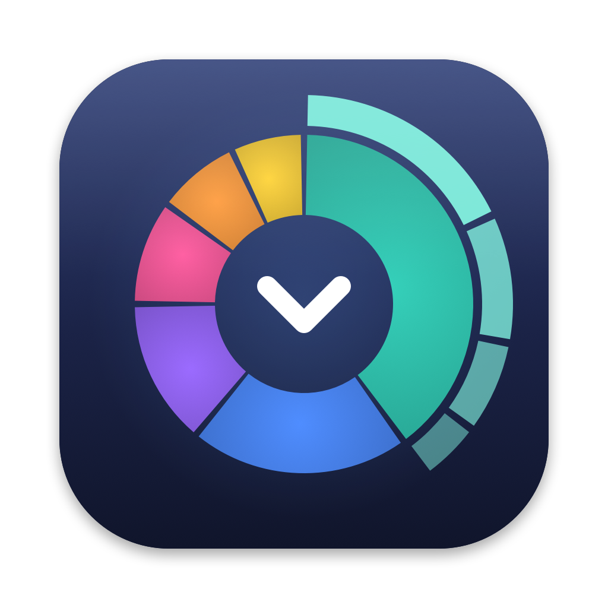

# Folder Drill



Where did my storage go? A small native macOS app (SwiftUI) for finding out.
(Formerly DiskDrill; renamed because "Disk Drill" is another company's trademark.)

It opens on your home folder, shows its total size on disk, and lists every
folder and file in it — hidden ones included — sorted by size. Double-click a
folder to drill into it; go back with ⌘[ or the breadcrumb.

## Features

- Scans the whole tree once in the background; sizes stream in as they're
  measured, and drilling into an already-measured folder is instant.
- Drilling into a folder that's still being measured splits its scan per
  subfolder so results appear sooner.
- Size, share-of-folder bar and file count for every row; sortable columns.
- Hidden items (dot-files and items with the macOS hidden flag, like
  `~/Library`) shown in grey.
- Right-click to Reveal in Finder, Copy Path, or Move to Trash (also ⌘⌫ on
  the selection). Trashing asks for confirmation, shows how much space it
  frees, and updates the totals of every parent folder without a rescan.
- ⌘O picks a different start folder or a drive, ⌘R rescans.

Sizes are allocated bytes on disk (what `du` reports): hard links are counted
once, symlinks aren't followed, and other volumes mounted inside a folder are
skipped.

## Install

Mac App Store: coming soon. Or download the latest `FolderDrill-x.y.z.dmg` from
[Releases](https://github.com/ancientcomputing/diskdrill/releases), open it, and
drag Folder Drill to Applications. It's a universal app (Apple silicon and Intel),
signed with a Developer ID and notarized by Apple.

## Build

Requires macOS 14+ and Xcode command-line tools.

```bash
./build.sh
open build/FolderDrill.app

# start somewhere other than ~/
open build/FolderDrill.app --args -start /Volumes/External
```

To make a signed, notarized release DMG in `dist/` (needs the ThisBrainAI LLC
Developer ID certificate and a notarytool keychain profile):

```bash
NOTARY_PROFILE=<profile> ./release.sh 1.0.0
```

### Mac App Store

The App Store build is sandboxed (`packaging/FolderDrill.entitlements`): it can only read folders
the user picks in an open panel, and keeps access to them with security-scoped bookmarks. On first
run it shows a setup screen that asks for the home folder. Move to Trash works on anything inside a
chosen folder. The GitHub build isn't sandboxed and opens on the home folder directly.

```bash
SANDBOX=1 ./build.sh                          # sandboxed build, for testing
VERSION=1.1.0 packaging/release-mas.sh        # → build/release-mas/FolderDrill-1.1.0.pkg
```

`release-mas.sh` signs with Apple Distribution, embeds the Mac App Store provisioning profile for
`ai.thisbrain.folderdrill` (found by bundle ID in Xcode's profiles folder) and builds an installer
package signed with the 3rd Party Mac Developer Installer certificate. Upload it with Transporter.

App Store screenshots come from a fake home folder (`packaging/screenshots/make_demo_home.py`:
about 230 GB as far as `du` can tell, 2 GB of real disk thanks to APFS clones) and the app's demo
mode:

```bash
packaging/screenshots/capture.sh store     # 4 App Store screenshots, 1440 x 900
packaging/screenshots/capture.sh review    # App Review shots of the folder setup; click Measure once
```

The app icon is drawn in code by `Icon/make_icon.swift`; after editing it, run
`swift Icon/make_icon.swift` to regenerate `Resources/AppIcon.icns` (and the
`Icon/AppIcon.png` preview), then rebuild.

## Privacy and support

Folder Drill collects nothing and never connects to the internet: see [PRIVACY.md](PRIVACY.md)
and [SUPPORT.md](SUPPORT.md).

## Full Disk Access

macOS blocks some folders (parts of `~/Library`, Mail, Safari, etc.), so their
sizes come out low and get a warning icon. Use the "Grant Full Disk Access…"
button in the footer, add Folder Drill, then press ⌘R.
